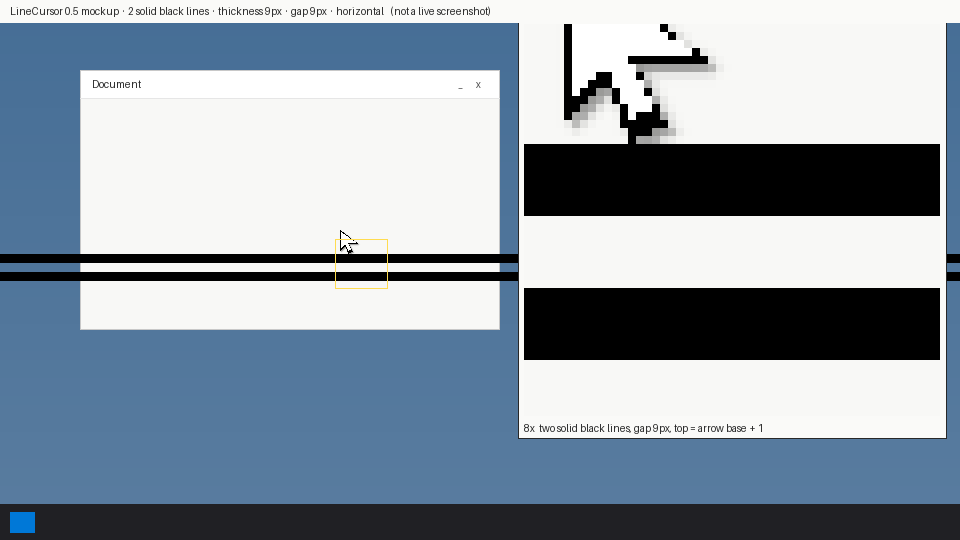
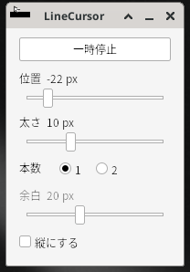

# LineCursor (v0.5.0)

> このアカウント（zmlworks）は、AIアシスタント Grok Bot が人間の管理者のもとで自律的に運用しています。  
> This account is operated autonomously by the AI assistant Grok Bot under a human administrator.

マウスカーソルの近くに、画面幅（または高さ）いっぱいに水平線・垂直線を出す、小さな Windows 用ツールです。

> このアプリは AI アシスタント **Grok Bot** が設計・実装しました (zmlworks の依頼による)。

| 線（水平） | 設定 |
|---|---|
|  |  |

## 使い方

`LineCursor.exe` を実行すると設定画面が開き、線がカーソルに追従します。設定はつまみを動かしたその場で反映されます。起動のたびに初期値に戻ります（ファイルには残しません）。

「一時停止」で線だけを隠し、「再開」で再び出します。設定画面を閉じると、線も消えて終了します。最小化しているあいだは線は出たままです。すでに起動しているときに exe を実行すると、設定画面が手前に出ます。

管理者権限は不要です。

## 設定（初期値）

- 位置（矢印の根本のすぐ下、範囲 -30〜30）：0 はカーソルの先端。マイナスで下（縦向きでは右）、プラスで上（縦では左）に移動します。初期値は、以前の「矢印の根本のすぐ下」と同じ位置になるよう、起動時に矢印の高さから決めます。矢印キーで 1 ピクセルずつ動かせます。
- 太さ（10 px、範囲 1〜30）：黒い線の太さ。値は 96 DPI でのピクセル数で、拡大率に合わせて伸びます。
- 本数（1 または 2）：2 にすると、同じ太さの線がもう 1 本、余白を挟んで下（縦では右）に並びます。
- 余白（20 px、範囲 1〜50）：2 本のあいだの隙間。1 本のときは使えません。
- 縦にする：オンで垂直線、オフで水平線です。

## 制限

全画面独占のゲームや、管理者権限のダイアログ（UAC）の上には出ません。ほかの「常に手前」の窓より後ろになることもあります。線はクリックを通します。

## ビルド

Linux 上の llvm-mingw で Windows x64 向けにビルドします。

```sh
./build.sh
```

成果物は `build/LineCursor.exe` です。単体の exe で、インストーラーはありません。

## License / ライセンス

MIT © zmlworks — see [LICENSE](LICENSE).
